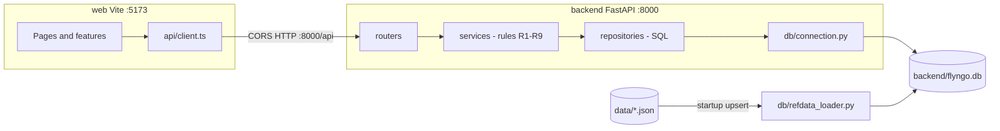

# FlyNGo: End-to-End Implementation Plan (Phase 1 MVP)

Source of truth: [docs/DESIGN.md](docs/DESIGN.md). Every rule, table, index and query comes from it. Where this plan makes a choice the document doesn't, it says so.

## Ground rules
- **When to code:** feature code during the event; Git history is checked. Pre-event: P0 only (data pack + docs). Push at least every hour during the event.
- **Toolchain (verified):** Node 24.3, npm 11.3, Python 3.13.5, Git 2.47.
- **Stack:** FastAPI + uvicorn; raw `sqlite3` (DESIGN.md appendices A/B); Vite + React + TypeScript + React Router; Tailwind + shadcn/ui.
- **Start (2 commands, 2 ports) — matches PS “1–2 commands”:**
  1. `npm run api` → FastAPI at **http://localhost:8000**
  2. `npm run web` → Vite at **http://localhost:5173**
  - Install once: `npm run setup` (`.venv`, pip, `web` npm install). Not counted as a “start” command.
  - Open the UI at `http://localhost:5173`. API calls go to `http://localhost:8000/api/...`.
  - FastAPI CORS allows `http://localhost:5173`. Frontend uses `import.meta.env.VITE_API_URL` (default `http://localhost:8000`).
  - No `concurrently`, no Vite `/api` proxy. Two terminals, two ports, clear ownership.
- **Rules live only in the backend.** Refusal shape: `{rule, field, message, allowed}`.
- **No SQL `DELETE`.** Every query includes `is_active = 1` literally.
- **Dictionary constraints to honour:**
  - Flight picker: `to ∈ {NRT,HND,KIX,DXB,AUH}` and arrival date in 2027-04-01..20 (departures may be 2027-03-31).
  - Non-null `car_type` on seeds (e.g. REQ-0002 SEDAN) must be enforced even when the traveler leaves type as “Any”.

## Modular design and principles

Build so each piece can be explained and swapped without rewriting the app.

| Principle | How we apply it |
|---|---|
| Separation of concerns | `routers` = HTTP only; `services` = rules/orchestration; `repositories` = SQL only; `db` = connection/schema/load |
| Dependency direction | UI → `api/client` → HTTP → routers → services → repositories → SQLite. Never reverse. |
| Single responsibility | One module, one job. No god files (>~300 lines → split). |
| Pure rules | R1–R9 as pure functions in `services/rules.py` (and focused helpers). Easy to unit-test without DB where possible. |
| Explicit over clever | Named rule codes, plain SQL from DESIGN.md, no hidden globals. |
| Fail loudly | Every refusal returns the rule + fix. No silent defaults that break judges. |
| YAGNI | Phase 1 = M1–M7 + G2 only. G1/G4/G5/S2 wait. |
| DRY at the right layer | Shared eligibility SQL in `eligibility_repo`; shared error type in `errors.py`; shared formatters in `web/src/lib`. |
| Test at the seam | Unit rules; API integration per router; UI components; one E2E Menon path. |
| Soft delete | `is_active` 0/1 only; never `DELETE`. |

**Frontend modularity:** feature folders (`features/traveler`, `features/supplier`, `features/booking`) own their cards and hooks; `components/ui` is shadcn only; `api/` is the only place that knows the backend URL.

**Backend modularity:** one router file per resource; services call repos, never `sqlite3` directly; repos never import FastAPI.

## Architecture

## Repository layout
- **Root:**
  - [package.json](package.json): scripts `setup`, `api`, `web`, `test` — **no** `concurrently`, **no** combined `dev`.
  - [scripts/setup.mjs](scripts/setup.mjs): create `.venv`, pip install, `npm install --prefix web` (Windows + Unix).
  - [scripts/run-api.mjs](scripts/run-api.mjs): `.venv` python `-m uvicorn backend.app.main:app --reload --port 8000 --app-dir .` (or equivalent from repo root).
  - [scripts/run-web.mjs](scripts/run-web.mjs) **or** `"web": "npm run dev --prefix web"`: Vite on 5173.
  - [scripts/test.mjs](scripts/test.mjs): pytest then `npm test --prefix web`; stop on first failure.
  - [.gitignore](.gitignore): `.venv`, `node_modules`, `web/dist`, `*.db`, `.env`, `web/.env.local`.
  - [web/.env.example](web/.env.example): `VITE_API_URL=http://localhost:8000`.
- **[backend/requirements.txt](backend/requirements.txt):** `fastapi`, `uvicorn[standard]`, `pytest`, `httpx`.
- **[backend/app/](backend/app/):**
  - `main.py`: lifespan (`init_db`, `load_reference_data`, `seed_open_requests`); CORSMiddleware; routers under `/api`; exception handlers.
  - `config.py`: `DB_PATH` (`FLYNGO_DB`), `DATA_DIR`, `CORS_ORIGINS` (default `http://localhost:5173`).
  - `errors.py`, `schemas.py` (Pydantic; validation → envelope with `rule: "INPUT"`).
  - `db/schema.sql` (Appendix A + `IF NOT EXISTS`), `connection.py`, `init.py`, `refdata_loader.py`, `seed.py`.
  - `repositories/`: `catalog_repo`, `eligibility_repo` (B.1–B.3), `request_repo`, `offer_repo`, `booking_repo`, `change_repo`.
  - `services/`: `rules.py`, `quote_service`, `request_service`, `offer_service`, `booking_service`, `change_service`.
  - `routers/`: `catalog`, `requests`, `suppliers`, `offers`, `bookings`, `changes`.
- **[backend/tests/](backend/tests/):** `conftest.py` (temp DB + TestClient); tests per phase.
- **[web/src/](web/src/):** `api/`, `lib/`, `components/ui`, `components/common`, `features/{traveler,supplier,booking}`, pages, `App.tsx`.

## Key implementation details
- **Reference loader:** per-table upsert; soft-deactivate missing keys; normalise datetimes to `YYYY-MM-DDTHH:MM`; `arrival_date` = first 10 chars; one transaction.
- **Seed:** `INSERT OR IGNORE` REQ-0001..0003; `passengers` = adults + children; keep `car_type` as in file.
- **Request ID:** `REQ-` + next 4-digit after max numeric suffix.
- **R1–R3 on POST /requests:** flight (arrival airport in the 5); hotel + serves city; adults ≥ 1; ages 0–17; bags ≥ 0; pickup landing+60 .. +24h; route + price in range. Return `errors[]` for all field failures.
- **R7 offer order:** not OPEN → 409; wrong supplier car → R7; car_type mismatch → R5/G2; airport/area/hours → R4; seats/bags → R5; busy → R6 (+ until); price → R3 (+ allowed).
- **Car badges:** advisory mode → `FITS_FREE` | `BUSY` | `TOO_SMALL` | `WRONG_TYPE`.
- **Booking (BEGIN IMMEDIATE):** offer+request OPEN; recheck overlap vs bookings + booked_rides; 10-digit number (`secrets`, retry); BOOKED + NOT_CHOSEN cascade; request BOOKED.
- **Change (R9):** same-airport new flight; R2 at submit; one WAITING; accept rechecks R2 + car free (exclude self) → ACCEPTED or auto REJECTED with reason; supplier reject keeps booking.
- **Request detail:** offers + range; if no eligible supplier, B.3 funnel + plain reason; else “N suppliers can serve. Waiting for offers.”

## Frontend details
- **Routes:** `/`, `/traveler`, `/traveler/new`, `/traveler/requests/:id`, `/bookings/:no`, `/supplier`, `/supplier/:id?tab=...`.
- **Request builder cards:** Airport → Date/Flight/Pickup → Hotel → Party/Bags → CarType (optional, fit-filtered) → Price (range bar) → Review. Chips + Edit; draft in `localStorage`.
- **Supplier:** tabs + Sheet; all cars selectable; server refusal via `RuleErrorAlert`.
- **Shared:** INR `en-IN`, “11:30 (NRT local)”, confirm dialogs, sonner, skeletons, empty states.
- **Refresh:** after actions, on focus, Refresh button — no websockets.

## Phases (sequential; tests green + commit + push at end of each)

**P0 — pre-event:** commit `data/`, `assets/`, dictionary, problem file, [docs/DESIGN.md](docs/DESIGN.md). Appendix A → `IF NOT EXISTS`. Commit: `docs: add data pack and design document`.

**P1 — foundation (~1 h):**
- Scripts: `setup`, `api`, `web`, `test`.
- Backend skeleton, schema, connection, loader, seed, CORS, `GET /api/health`.
- Vite + Tailwind + shadcn shell, role picker, `VITE_API_URL`.
- `test_refdata.py`: §5 counts; idempotent reload; time normalisation.
- **Done when:** terminal A `npm run api` + terminal B `npm run web` show the role picker; `http://localhost:8000/api/health` returns counts.

**P2 — M1 (~1.5 h):** catalog/quote/car-types/requests APIs; request builder; happy/unhappy R1–R3 tests. Done: Menon as REQ-0004; ₹9,000 refused with range.

**P3 — M2/M3 (~1.5 h):** dashboards B.2; cars; offers; funnel; supplier UI; eligibility tests (Menon SC-2 R6, seeds, Marina overnight, EXPLAIN indexes).

**P4 — M4/M5/M6 (~1.25 h):** book/reject; summary; 404; double-book 409; restart persistence test.

**P5 — M7 (~1 h):** changes API + UI; accept/reject/auto-reject tests.

**P6 — UX + E2E (~1.25 h):** mobile/a11y/states; Vitest; Playwright against both ports; judge-style manual.

**P7 — ship (~45 min):** README documents **exactly** the two start commands + ports; fresh-clone prove; demo ×2; `git archive` zip.

**Phase 2 (only if early):** G1, G4, G5. **Phase 3:** S2.

## Menon demo (4 min)
1. Post Menon (show ₹9,000 refuse, then ₹12,000).
2. Sakura: refuse SC-2 (R6), assign SC-3.
3. Edo: assign EP-2.
4. Reject Edo, book Sakura → 10-digit summary.
5. Change pickup 12:00 → accept.
6. Backup: REQ-0002 “no supplier” reason.

## Definition of done (Phase 1)
- Clean clone: `npm run setup`, then `npm run api` and `npm run web` in two terminals.
- UI at :5173 talks to API at :8000.
- `npm test` green (pytest → Vitest → Playwright).
- Every R1–R9 and M1–M7 has ≥1 passing test.
- Demo runs clean twice.
