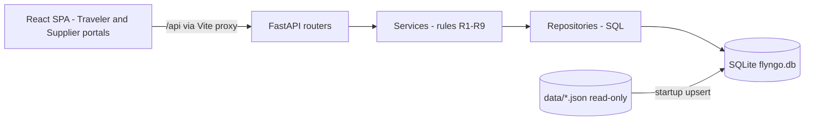

# FlyNGo: docs/DESIGN.md (content to be written)

The decisions below were all made in chat. The file is written only after this plan is approved. The style is short, concise points.

---

## 1. Overview
- A web app where travelers post an airport-to-hotel ride request with their price, suppliers assign cars, and travelers book one.
- There are two portals: Traveler and Supplier. There is no login; the user picks a role.

## 2. Scope (phases)
- **Phase 1, the MVP (focus):** M1–M7, all of them made strong.
  - Also in Phase 1: the optional car-type card (G2), showing only the types that can fit the party.
- **Phase 2:** G1 (several cars per supplier per request), G4 (offer expiry), G5 (sort and filter).
- **Phase 3:** S2, our own ideas, decided after the MVP.

## 3. Assumptions (agreed)
- Every time is local time at the arrival airport, so there is no time-zone conversion. This is a stated fact in the data dictionary.
- Busy times are half-open: a ride starting exactly when another ends does not overlap (dictionary fact).
- Opening hours include both ends, and a window can cross midnight (05:00–01:00).
- If no pickup time is given, the default is landing + 60 minutes. A later pickup is allowed up to 24 hours after landing.
- A change to a new flight must land at the same airport.
- The traveler's change request is checked against R2 when it is sent. The car-free check runs when the supplier accepts.
- If the checks fail when the supplier clicks Accept, the platform rejects the change automatically with the reason, and the booking is unchanged.
- A booked request leaves every supplier dashboard, and no new cars can be assigned to it.
- A supplier can assign a given car only once per request.
- The seeded requests keep REQ-0001..0003. New requests continue from REQ-0004.
- The booking number is 10 random digits with a non-zero first digit, unique, and regenerated if it collides.
- With no login, the traveler's request IDs are kept in the browser. Any booking opens by its number.
- A supplier's price can differ from the traveler's price, but it must be inside the range (problem FAQ).
- **Open question for the help desk:** do new requests need a traveler name? The seeded requests carry `traveler_name`.

## 4. Out of scope (this hackathon)
- S1 shared ride.
- Login, payments, online deployment, real-time or dynamic pricing, notifications, maps, and any AI or LLM call.
- Two people booking the same car at the same moment. Sequential correctness is enough, per the FAQ.
- Changing the data files.
- User-facing delete actions. Soft delete exists in the schema only.

## 5. Verified data facts
- 11 suppliers and 28 cars: 11 SUV, 8 Sedan, 5 Bus, 4 Hatchback. The largest car has 9 seats, 6 large bags and 6 small bags.
- 469 flights, of which 240 land at NRT, HND, KIX, DXB or AUH, dated 1–20 April 2027. At most 5 flights per airport per day (2.5 on average).
- 49 hotels; per airport: NRT 13, HND 13, KIX 22, DXB 14, AUH 6.
- 33 routes, with prices from ₹700 to ₹23,900 and drives of 16 to 134 minutes. Every pair that R1 allows has a route.
- All 3 open requests pass R1–R3.
- For Menon, SC-3, EP-1 and EP-2 can be assigned. SC-2 is busy (booked ride from 11:00 to 14:00).
- 26 of the 3,168 valid flight-and-hotel pairs have no supplier at the earliest pickup (DXB to Abu Dhabi, and KIX to Osaka).

## 6. Architecture
- **Stack:** FastAPI (Python 3.13), Vite + React + TypeScript + React Router, SQLite (`sqlite3`, version 3.49).
- **Run:** `npm run setup` once, then `npm run dev`. One terminal runs uvicorn and Vite, and Vite forwards `/api` to FastAPI. Open one URL.
- **Layers:** routers, then services (the rules), then repositories (SQL), then SQLite. The rules live only in the backend.
- **Startup:** create the schema if it's missing, upsert the reference JSON by ID (rows no longer in the files get `is_active = 0`), and seed the open requests once.

- **Folders:** `backend/app/{routers,services,repositories,db}`, `backend/tests`, `web/src/{pages,components,api}`, `docs/`, and `data/` (unchanged).

## 7. UX

### Traveler portal: a progressive single page
One card at a time. An answered card collapses into a chip that can be edited.
1. **Airport:** only the 5 arrival airports.
2. **Date, flight and pickup time:**
   - The date is required.
   - The flights for that airport and date are listed (at most 5).
   - Pickup is prefilled as landing + 60 minutes and can be edited, with the R2 message shown inline.
3. **Hotel:** only hotels in cities the airport serves, with prefix search.
4. **Passengers and bags:** an adults stepper (minimum 1), child age chips (0–17), and large and small bag steppers with a hint.
5. **Car type (optional):** defaults to "Any". Only types that can fit the party are shown; for example, 7 passengers shows SUV and Bus.
6. **Price:** a typed number, with a range bar showing minimum, midpoint, maximum and the traveler's marker. An out-of-range price gets the R3 message showing the range.
7. **Review:** every chip with Edit links, then "Post request". The draft is saved in the browser.

**After posting:** the offers list shows supplier, car and price, with Book and Reject buttons. If no supplier can serve the request, the page names the first failing step and why.

**Booking page:** the 10-digit number, the summary, the change form and the change result. A wrong number shows "not found".

### Supplier portal
- Choose a company from the list.
- Tabs with counts: Requests you can serve, Your offers, Bookings, Change requests.
- Clicking a request opens a side panel with all its details and the assign form.
- **Car picker:** every car is shown with an advisory badge (Fits and free / Busy until 14:30 / Too small: 4 seats < 5). Every car can be selected, and the server refuses a bad pick with the rule and the reason.

## 8. Database architecture (SQLite)
- **Conventions:**
  - Every table has `is_active INTEGER NOT NULL DEFAULT 1 CHECK (is_active IN (0,1))`, plus `created_at` and `updated_at`.
  - The code never runs SQL `DELETE`.
  - Times are stored as text in the form `YYYY-MM-DDTHH:MM`, so comparing two strings compares the times.
- **Reference tables (loaded from JSON):**
  - `airports`
  - `airport_cities(airport_code, city)`
  - `flights` (all 469, plus a derived `arrival_date`)
  - `hotels`
  - `routes` (key: airport, city, area)
  - `suppliers`
  - `supplier_airports`
  - `supplier_areas`
  - `vehicles`
  - `booked_rides`
- **App tables:**
  - **`ride_requests`:** `request_id`, `source` (SEED or APP), flight, hotel, a snapshot of `airport_code`, `city` and `area`, `adults`, bags, `pickup_local`, `car_type`, `price_inr`, `status`.
  - **`request_children`:** `request_id`, `child_no`, and `age` limited to 0–17.
  - **`offers`:** request, supplier, vehicle, `price_inr`, `status`.
  - **`bookings`:** `booking_number` (the key, CHECK that it is 10 digits), request, offer, supplier, vehicle, flight, `pickup_local`, `busy_start`, `busy_end`, `price_inr`, `status`.
  - **`change_requests`:** `booking_number`, supplier, the old flight and pickup, the new flight and pickup, `status`, `reason`.
- **Statuses (the data dictionary's words):**
  - Request: OPEN, then BOOKED.
  - Offer: OPEN, then BOOKED, REJECTED or NOT_CHOSEN.
  - Booking: CONFIRMED.
  - Change: WAITING, then ACCEPTED or REJECTED.
- **Car busy check:** a car's busy time comes from `bookings` and `booked_rides` together, in one query. There is no extra table.

## 9. Key queries (all prototyped on the real data)
- **Flights for a card:** `WHERE to_airport = ? AND arrival_date = ? AND is_active = 1`.
- **Hotels for an airport:** join `airport_cities` to `hotels` on the city, plus `name LIKE 'prefix%'`. This uses the index (EXPLAIN shows a search, not a scan).
- **Price range:** a key lookup on `routes` by (airport, city, area).
- **Eligible cars (R4, R5, R6), one query:**
  - join suppliers to `supplier_airports` and `supplier_areas`;
  - check opening hours with a CASE expression that handles windows crossing midnight;
  - join to fitting cars;
  - `NOT EXISTS` an overlapping booking, and `NOT EXISTS` an overlapping booked ride.
  - Results checked: Menon gives SC-3, EP-1 and EP-2; at 14:00 SC-2 is free; Marina is open at 00:30.
- **Overlap test:** `existing_start < new_end AND new_start < existing_end`.
- **Supplier dashboard:** the same checks run for the supplier's id across all OPEN requests. It is computed on every read, so it is never out of date.
- **"No supplier" reason:** one query counts the suppliers passing each step (airport, then area, then open, then fits, then free) and reports the first step that reaches 0.
- **Rule:** every query includes `is_active = 1` literally. Without it the partial indexes aren't used (verified).

## 10. Indexes
- Partial indexes on active rows (`WHERE is_active = 1`):
  - `flights(to_airport, arrival_date)`
  - `hotels(city, name COLLATE NOCASE)`
  - `vehicles(supplier_id, type)`, which fixes the table scan seen in EXPLAIN
  - `booked_rides(vehicle_id, start_local, end_local)`
  - `bookings(vehicle_id, busy_start, busy_end)`
  - `ride_requests(status, airport_code)`
  - `offers(request_id, status)` and `offers(supplier_id, status)`
  - `change_requests(supplier_id, status)`
- Primary keys used as lookup indexes:
  - `routes(airport, city, area)`
  - `supplier_airports(airport_code, supplier_id)`
  - `supplier_areas(city, area, supplier_id)`
- Partial unique indexes enforcing business rules (all verified):
  - one active booking per request
  - one active offer per (request, vehicle)
  - one WAITING change per booking

## 11. Rule enforcement map
- **R1–R3:** on `POST /requests`; the frontend only gives hints.
- **R4:** the dashboard query and the "no supplier" reason.
- **R5–R7:** on `POST /offers`; a refusal returns the rule code and the reason.
- **R8 and M6:** on `POST /offers/{id}/book`, which rechecks that the car is free, creates the booking, and marks the other offers NOT_CHOSEN.
- **R9:** R2 is checked on `POST /bookings/{no}/changes`; R2 and the car being free are checked again on accept.
- **Error shape:** `{rule, field, message, allowed}`.

## 12. API (short)
- `GET /airports`, `/flights?airport&date`, `/hotels?airport&q`, `/quote?flight_id&hotel_id`, `/car-types?pax&large&small`
- `POST /requests`, `GET /requests/{id}`
- `GET /suppliers`, `/suppliers/{id}/requests`, `/suppliers/{id}/requests/{rid}/cars`, `/suppliers/{id}/offers|bookings|changes`
- `POST /requests/{id}/offers`, `/offers/{id}/book`, `/offers/{id}/reject`
- `GET /bookings/{no}`, `POST /bookings/{no}/changes`, `POST /changes/{id}/accept|reject`

## 13. Testing (short)
- **pytest:** happy, unhappy and boundary cases for every rule, using the Menon fixture and the facts in section 5.
- **API tests:** a temporary SQLite file per test, every status code, and a restart check (restart the backend, then open the booking).
- **Frontend:** Vitest checks on the cards, and one Playwright test covering the Menon demo flow.
