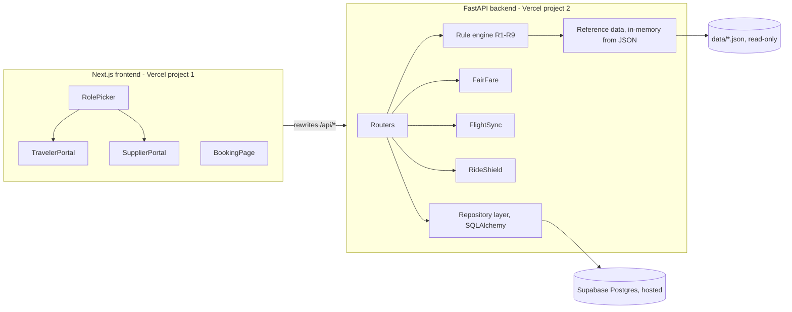

# FlyNGo: Airport Taxi Ride Offers, Sprint Plan

## Ground rules that shape this plan
- **Git history is checked.** Before the event, only install tools, create accounts and practise. Write all feature code during the event, push every hour, and use small conventional commits with both members committing.
- **The data files are read-only.** Copy `data/problem-2/*.json`, `data/catalog/*.json` and `DATA_DICTIONARY.md` into `data/` unchanged. The backend loads them into memory at startup and never writes them. The database stores only app state: requests, offers, bookings, change requests and audit history.
- **The app calls no AI or LLM.** Every "smart" feature is a deterministic formula or rule.
- **The backend owns all rules.** The frontend only renders what the API returns. Every refusal returns `{error: {rule: "R5", field, message}}`.
- **Startup takes 2 commands:** `npm run setup` (creates the Python virtual environment, runs pip install and npm install), then `npm run dev` (uses `concurrently` to run uvicorn on port 8000 and Next.js on port 3000).

## Architecture

### Repository layout
- [data/](data/): the original files, untouched.
- [backend/app/](backend/app/) contains:
  - `main.py`: the FastAPI app, CORS and the error handler.
  - `refdata.py`: loads the JSON files into Pydantic models and builds indexes for flights by id, hotels, routes keyed by `(airport, area)`, and suppliers and cars.
  - `rules/`: pure functions with no database access. `request.py` covers R1–R3, `eligibility.py` covers R4–R6, `offers.py` covers R7–R8 and `changes.py` covers R9.
  - `engines/`: `fairfare.py`, `flightsync.py` and `rideshield.py`.
  - `db.py` and `models.py`: SQLAlchemy 2 with psycopg3 and `NullPool`, connected through the Supavisor transaction pooler on port 6543 with prepared statements disabled.
  - `routers/`: `catalog.py`, `requests.py`, `suppliers.py`, `offers.py`, `bookings.py` and `changes.py`.
  - `seed.py`: idempotently loads `open_requests.json` into `ride_requests`, using `source_ref` as a unique key.
- [backend/tests/](backend/tests/): pytest tests for the rule engine, including the Menon fixtures and edge cases.
- [api/index.py](api/index.py): the Vercel entry point (`from backend.app.main import app`). The root [vercel.json](vercel.json) bundles `data/**` into the function with `includeFiles`. The root `.vercelignore` excludes `web/`.
- [web/](web/): a Next.js App Router project with TypeScript and Tailwind. It is a separate Vercel project with Root Directory set to `web`, and `next.config` rewrites `/api/*` to the backend URL so no CORS setup is needed.
- [supabase/migrations/](supabase/migrations/): created with `supabase init`, `supabase link --project-ref <ref>`, `supabase migration new init_schema` and `supabase db push`.
- `scripts/smoke.py`: drives the full Menon demo through the API and asserts every step.
- `README.md`: start commands, architecture, what was finished, known limitations.

## Data model (Supabase migration)
- **`ride_requests`**: `id uuid`, `source_ref text unique null` (for seeded open requests), `flight_id`, `hotel_id`, `airport_code`, `city`, `area`, `adults int check >=1`, `child_ages int[]`, `large_bags`, `small_bags`, `pickup_at timestamp` (airport local time), `traveler_price_inr int`, `car_type null` (G2), `status` (OPEN, BOOKED), `created_at`.
- **`offers`**: `id`, `request_id fk`, `supplier_id`, `car_id`, `price_inr`, `status` (ASSIGNED, REJECTED, NOT_CHOSEN, BOOKED), `expires_at null` (G4), `unique(request_id, car_id)`.
- **`bookings`**: `booking_number char(10) unique`, `request_id unique`, `offer_id unique`, `supplier_id`, `car_id`, `flight_id`, `pickup_at`, `busy_start`, `busy_end`, `price_inr`, `created_at`, `updated_at`.
  - As defence in depth, add an `EXCLUDE USING gist (car_id WITH =, tsrange(busy_start, busy_end) WITH &&)` constraint using `btree_gist`.
- **`change_requests`**: `booking_id fk`, `old_flight_id`, `old_pickup_at`, `new_flight_id null`, `new_pickup_at`, `status` (PENDING, ACCEPTED, REJECTED), `decision_reason`, `decided_at`.
  - A partial unique index allows only one PENDING change per booking.
- **`audit_events`**: `entity`, `entity_id`, `event`, `payload jsonb`, `at`.
- **Indexes**: `offers(request_id)`, `offers(supplier_id)`, `bookings(car_id)`, `ride_requests(status)`, `change_requests(booking_id, status)`.
- **Row-level security** is enabled on every table with no policies. Only the backend's direct Postgres connection can access the data; the public anon key gets nothing.

## Rule engine decisions to lock in during Sprint 1
- **Times:** all times are naive local airport time, because flights are given in local time. Busy windows are half-open intervals `[pickup, pickup + 2 x drive_minutes)`, so two rides that only touch end-to-start do not overlap.
- **Car availability** combines confirmed `bookings` with `booked_rides.json`. An unbooked offer never makes a car busy.
- **Opening hours** handle overnight wrap (for example 22:00–06:00) and 24-hour suppliers.
- **Passenger and bag limits:** passengers = adults + number of children. Child ages must be integers from 0 to 17. Bag counts must be non-negative integers. Prices must be positive integers.
- **R1:** the flight and hotel must exist, and the arrival airport's served cities must include the hotel's city.
- **R2:** pickup must be at least landing + 60 minutes. If the traveler leaves pickup empty, it defaults to the FlightSync recommendation, which is never earlier than 60 minutes after landing.
- **R7:** the backend reruns R4, R5 and R6 plus the price range for the chosen car, and returns the first failing rule with a precise message (for example "R5: car seats 4 < 5 passengers").
- **R8 and M6:** booking reruns RideShield. It refuses the booking if the offer is REJECTED, NOT_CHOSEN or expired, or if the car is now busy. On success it generates a 10-digit number with `secrets.randbelow(9*10**9) + 10**9`, retries if the unique constraint is hit, and marks the request's other offers NOT_CHOSEN in the same transaction.
- **R9:** a new flight must land at the same airport, because the route and supplier depend on it; otherwise the change is refused with that reason. Accepting a change checks only R2 and that the same car is free at the new time, excluding this booking's own window, exactly as the spec says. On acceptance the pickup and busy window update. A rejected change keeps the old booking.
- **M2 "nobody can serve this":** an eligibility funnel reports counts at each step (works at airport, drives to city and area, open at pickup, has a car that fits, has a fitting car that is free) and names the first step where the count drops to 0.

## Differentiators (deterministic, no AI)
- **FairFare.** The quote endpoint returns the minimum, maximum, midpoint and `position = (price - min) / (max - min) x 100`. The form shows a live range bar with the traveler's price marker. Each offer gets factual labels such as "Rs 800 below your price", "at 22% of the route range" or "lowest of 3 offers on this request". It never claims "cheapest on the market". The Menon example, Rs 12,000 within Rs 10,200–16,800, shows 28.6%; the 28.8% in your brief appears to be a slip.
- **FlightSync.** `T_pickup = landing + immigration (25) + baggage (20 if any large bags, else 10) + buffer (15)`, never less than landing + 60 minutes. The Menon flight lands at 10:30, so the recommendation is 11:30, which matches the spec. The UI shows each component, and the original and revised pickup side by side. Travelers can pick a new catalog flight, or enter a delay in minutes; either produces a revised pickup that is sent as an R9 change request, and the supplier must accept it.
- **RideShield.** `GET /api/offers/{id}/shield` returns a checklist: passengers fit, luggage fits, fare is within range, pickup is at least 60 minutes after landing, the car is available when rechecked now, and the offer has not expired. The Book button stays disabled until every check passes, and booking runs the same check again on the server. The checklist shows no made-up ratings or probabilities.
- **AirportMeet.** The booking summary page shows a QR code (`qrcode.react`) encoding the booking URL, plus pickup instructions built only from the data (airport, pickup time, supplier, car type) and a generic "show this code at arrivals" line.

## API surface
- `GET /api/catalog/{flights,hotels,airports,suppliers}` (flights can be filtered by date).
- `GET /api/quote?flight_id&hotel_id` returns the price range, FairFare data, `drive_minutes` and the FlightSync breakdown.
- `POST /api/requests` and `GET /api/requests/{id}` (which includes the offers, FairFare labels and the eligibility funnel).
- `GET /api/suppliers/{id}/requests`, `GET /api/suppliers/{id}/requests/{rid}/cars` (each car with fit and free hints), `GET /api/suppliers/{id}/bookings` and `GET /api/suppliers/{id}/changes`.
- `POST /api/requests/{id}/offers`, `POST /api/offers/{id}/reject`, `GET /api/offers/{id}/shield` and `POST /api/offers/{id}/book`.
- `GET /api/bookings/{number}` returns 404 "Booking not found" for an unknown number, and `POST /api/bookings/{number}/changes`.
- `POST /api/changes/{id}/accept` and `POST /api/changes/{id}/reject`.

## Frontend pages
- `/`: role picker (traveler, or a supplier chosen from the data).
- `/traveler/new`: the request form, which needs these pieces:
  - flight search by number and date (1–20 April 2027 only)
  - a hotel list filtered to the cities the arrival airport serves
  - one age field per child
  - bag counts, an optional pickup time and an optional car type
  - a price field with the live FairFare bar and inline rule errors
- `/traveler/requests/[id]`: offer cards (supplier, car, price, FairFare labels, RideShield), sorting by price and filtering by car type (G5), Book and Reject buttons, and the explanation when no supplier can serve the request.
- `/booking` (lookup) and `/booking/[number]`: the summary, AirportMeet QR, the FlightSync change form and the change history.
- `/supplier/[id]`: tabs for Open requests, My offers, Bookings and Change requests.
- `/supplier/[id]/requests/[rid]`: assign a car with a price. The car list deliberately includes cars that break a rule, so the server's refusal can be shown. Assigning several cars is allowed (G1), the car type is enforced (G2), and an optional expiry can be set (G4).
- Traveler request ids are kept in `localStorage` so the "My requests" list survives a refresh. There is no login.

## Sprints (event clock about 9.5 h; A = backend lead, B = frontend lead; each member reviews the other's PRs so both can explain all of the code)

**Sprint 0, before the event (setup only, no feature code):** install Python 3.12, Node 20, the Supabase CLI and the Vercel CLI. Run `supabase login` and `vercel login`, and create the empty hosted Supabase project and two Vercel projects. Rehearse the Menon demo script on paper, and agree on the error envelope and naming.

**Sprint 1, 0:00–1:00, foundations.**
- A: scaffold FastAPI, write `refdata.py` against `DATA_DICTIONARY.md`, then `supabase init`, link the project, write the first migration and run `db push`.
- B: run `create-next-app`, add Tailwind, the role picker, the API client and the rewrites, and set up the root `npm run setup` and `npm run dev` scripts.
- Both: deploy skeletons to both Vercel projects and confirm `/api/health` returns the database status. First hourly push.

**Sprint 2, 1:00–2:30, rules R1–R6 and the request form (M1).**
- A: pure rule functions and pytest cases. Menon passes. Price 9,000 fails R3, pickup 11:00 fails R2, 0 adults fails R1, a child aged 18 fails R1, overnight opening hours work, and the busy-overlap boundaries behave as half-open intervals. Then the quote endpoint, `POST /api/requests` and the seed loader.
- B: the request form with flight and hotel pickers, child ages, the FairFare bar and inline errors mapped by `field`.

**Sprint 3, 2:30–4:00, supplier side (M2, M3, R7, G1, G2).**
- A: the eligibility funnel, supplier request listing, car hints, offer creation with rule-coded refusals and car-type enforcement.
- B: the supplier dashboard and assign page, the refusal toast showing the rule code, and the traveler's "no supplier can serve this" panel.

**Sprint 4, 4:00–5:30, book, reject and summary (M4, M5, M6, G4, G5).**
- A: the RideShield endpoint, a transactional book endpoint (busy-window check against bookings plus `booked_rides.json`, booking number generation, NOT_CHOSEN cascade), reject, expiry and the booking lookup with 404.
- B: offer cards with sort and filter, the RideShield checklist, Book and Reject, the booking summary with the AirportMeet QR, and the lookup page. Test that a booking survives restarting the backend.

**Sprint 5, 5:30–6:45, changes (M7 and FlightSync).**
- A: the FlightSync engine, change creation (new flight, or new pickup or delay), and accept or reject with the R9 checks and an audit event.
- B: the change form showing original and revised pickup, the supplier's change-request queue, and the booking page result banner.

**Sprint 6, 6:45–8:00, adversarial hardening.**
- Both: write `scripts/smoke.py`, which runs the full Menon flow including one refused car, one rejected taxi, booking, opening the booking and an accepted change.
- Act as judges: try other airports, a suitcase-heavy family, a BUS-only request, out-of-range prices, malformed input (negative bags, missing flight, dates outside 1–20 April), double booking the same car, and a change that collides with another booking.
- Fix whatever breaks. Check empty and loading states, and that every error message is readable.

**Sprint 7, 8:00–9:00, ship.**
- Deploy to Vercel production and set environment variables (`DATABASE_URL` on the backend, `API_URL` on the web project).
- Finish the README: the 2 start commands, the architecture diagram, the Must, Good and Stretch status, the time-zone and same-airport-change assumptions, and known limitations.
- Rehearse the 4-minute demo twice with a stopwatch.

**Sprint 8, 9:00–9:30, code freeze.** Make the final push, then build the zip with `git archive` so it contains no `node_modules`, `.venv`, `.next` or `.env`. Upload it to HackerEarth and keep the app running locally for the slot.

**Out of scope unless time remains:** the S1 shared ride. Being cut for time is listed in the README's known limitations.

## Risks and mitigations
- **Field names are unknown until the data arrives.** Isolate all parsing in `refdata.py` and spend the first 20 minutes reading `DATA_DICTIONARY.md`.
- **Venue internet is down while using hosted Supabase.** Tether a phone as backup. All rule logic is in memory and unit-tested, so the logic itself does not depend on the database.
- **Vercel Python cold starts or bundling `data/`.** Deploy in Sprint 1, not at the end. The live demo runs locally regardless.
- **Judges probe edge cases.** The rule engine is pure and fully unit-tested, and every refusal carries its rule code and the allowed range or limit.
