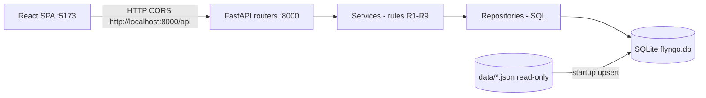

# FlyNGo: Design Document

Airport Taxi → Ride Offers (Hackathon Problem 2).

## 1. Overview

- A web app where travelers post an airport-to-hotel ride request with their price. Suppliers assign cars, and the traveler books one.
- It has two portals, Traveler and Supplier. There is no login; the user picks a role, and as a supplier picks a company from the data.
- Sources: `problem-2-airport-taxi-offers.md`, `DATA_DICTIONARY.md`, `data/`.

## 2. Scope

| Phase | Contents |
|---|---|
| **1: MVP (focus)** | M1–M7, all made strong, plus the optional car-type card (G2) showing only types that can fit the party |
| **2** | G1 several cars per supplier per request, G4 offer expiry, G5 sort and filter |
| **3** | S2: our own ideas, decided after the MVP |

## 3. Assumptions

- **Times:** every time is local to the arrival airport; there is no time-zone conversion (data dictionary §5).
- **Busy times:** half-open. A ride that starts exactly when another ends does not overlap (data dictionary §5).
- **Opening hours:** both ends are included, and a window can cross midnight (`05:00`–`01:00`).
- **Pickup:** if none is given, the default is landing + 60 min. The latest allowed pickup is landing + 24 h.
- **Flight change:** the new flight must land at the same airport.
- **Change checks:**
  - R2 is checked when the traveler sends the change.
  - R2 and the car being free are checked again when the supplier accepts.
  - If they fail at Accept, the change is rejected automatically with the reason, and the booking is unchanged.
- **Booked request:** it leaves all supplier dashboards, and no new cars can be assigned to it.
- **One offer per car:** a car can be assigned only once per request.
- **Request IDs:** seeded requests keep `REQ-0001`..`REQ-0003`. New requests continue from `REQ-0004`.
- **Booking number:** 10 random digits with a non-zero first digit, unique, and regenerated if it collides.
- **No login:** the traveler's request IDs are kept in the browser. Any booking opens by its number.
- **Supplier price:** it can differ from the traveler's price, but must be inside the route range (problem FAQ).
- **Open question (help desk):** do new requests need a traveler name? Seeded requests have `traveler_name`, so the column exists and is optional.

## 4. Out of scope

- S1 shared ride.
- Login, payments, online deployment, real-time or dynamic pricing, notifications, maps.
- Any AI or LLM call inside the app.
- Two people booking the same car at the same moment. Sequential correctness is enough (problem FAQ).
- Changing the data files.
- User-facing delete actions. Soft delete exists in the schema only.

## 5. Verified data facts

- **Suppliers and cars:** 11 suppliers and 28 cars (11 SUV, 8 Sedan, 5 Bus, 4 Hatchback). The largest car has 9 seats, 6 large bags and 6 small bags.
- **Flights:** 469 in total; 240 land at NRT, HND, KIX, DXB or AUH between 1 and 20 April 2027. Each airport has at most 5 flights per day (2.5 on average).
- **Hotels:** 49. By arrival airport: NRT 13, HND 13, KIX 22, DXB 14, AUH 6.
- **Routes:** 33. Prices run from ₹700 to ₹23,900 and drives from 16 to 134 min. Every pair R1 allows has a route.
- **Open requests:** all 3 pass R1–R3.
  - REQ-0001 is visible to TX-JP-01, TX-JP-03 and TX-JP-04.
  - REQ-0003 is visible to TX-AE-02 and TX-AE-04.
  - REQ-0002 (KIX to Namba, `SEDAN`) has no supplier: Kansai Airport Taxi has no Sedan, and Kyoto Night Cabs doesn't drive to Osaka. It is a ready-made "no supplier" demo case.
- **Menon:** SC-3, EP-1 and EP-2 can serve. SC-2 is busy because booked ride RIDE-0001 runs 11:00–14:00.
- **No supplier:** 26 of the 3,168 valid flight-and-hotel pairs have no supplier at the earliest pickup (DXB to Abu Dhabi: 16; KIX to Osaka: 10).

### Car types (limits in the data)

| Type | Max seats | Max large bags | Max small bags |
|---|---|---|---|
| Hatchback | 4 | 1 | 2 |
| Sedan | 4 | 3 | 2 |
| SUV | 7 | 4 | 4 |
| Bus | 9 | 6 | 6 |

## 6. Architecture

- **Stack:** FastAPI (Python 3.13), Vite + React + TypeScript + React Router, Tailwind + shadcn/ui, SQLite (`sqlite3`, version 3.49, raw SQL).
- **Run (2 commands, 2 ports):**
  1. Backend: `npm run api` → FastAPI on `http://localhost:8000`
  2. Frontend: `npm run web` → Vite on `http://localhost:5173`
  - Install once first: `npm run setup` (creates `.venv`, pip install, `web` npm install).
  - The browser opens `http://localhost:5173`. The web app calls the API at `http://localhost:8000/api/...` (CORS enabled for the Vite origin).
- **Layers (modular):** routers → services (all rules) → repositories (SQL) → SQLite. The frontend holds no rules. Each module has one job; no god files.
- **Startup:**
  - Create the schema if it's missing.
  - Upsert the reference JSON by ID; rows that disappear from the files get `is_active = 0`.
  - Seed the open requests once.



**Folders (modular by layer and by feature):**
- `backend/app/{routers,services,repositories,db}` — one concern per package; routers have no SQL; services have no HTTP; repositories have no rule branching beyond queries
- `backend/tests` — mirrors packages (`test_rules`, `test_eligibility`, `test_*_api`)
- `web/src/{api,lib,components,features/{traveler,supplier,booking},pages}`
- `docs/`, `data/` (unchanged)

**Principles:**
- Separation of concerns; dependency direction always inward toward the DB/rules
- Pure, testable rule functions; side effects only at the edges (HTTP, SQLite)
- Small modules, explicit names, no shared mutable globals
- Fail with a clear rule code; never fail silently
- YAGNI for Phase 1: only M1–M7 + G2 car-type

## 7. UX

### Traveler portal: a progressive single page

One card at a time. An answered card collapses into a chip that can be edited.

1. **Airport:** only the 5 arrival airports.
2. **Date, flight and pickup:**
   - The date is required.
   - The flights for that airport and date are listed (at most 5).
   - Pickup is prefilled as landing + 60 min and can be edited; R2 is shown inline.
3. **Hotel:** only hotels in cities the airport serves, with prefix search.
4. **Passengers and bags:**
   - An adults stepper (minimum 1) and child age chips (0–17).
   - Large and small bag steppers, with the hint "large = check-in, small = cabin".
5. **Car type (optional):** defaults to "Any". Only types that can fit the party are shown; for example, 7 passengers shows SUV and Bus.
6. **Price:** typed as a number, above a range bar showing minimum, midpoint, maximum and the traveler's marker. A price outside the range gets the R3 message with the range.
7. **Review:** every chip with an Edit link, then **Post request**. The draft is saved in the browser.

**After posting:**
- **Offers:** supplier, car and price, with **Book** and **Reject**.
- **No supplier can serve it:** the page names the first step that fails and why.

**Booking page:**
- The 10-digit number, the summary (flight, hotel, pickup, supplier, car, price), the change form, and the change result.
- A wrong number shows "Booking not found".

### Supplier portal

- Choose a company, then four tabs with counts: **Requests you can serve**, **Your offers**, **Bookings**, **Change requests**.
- Clicking a request opens a side panel with every request detail and the assign form.
- **Car picker:**
  - Every one of the supplier's cars is shown with an advisory badge: `Fits and free`, `Busy until 14:30`, `Too small: 4 seats < 5`.
  - Every car can be selected. The server refuses a bad pick with the rule and the reason.

## 8. Database architecture (SQLite)

**Conventions:**
- **Soft delete:** every table has `is_active INTEGER NOT NULL DEFAULT 1 CHECK (is_active IN (0,1))`, plus `created_at` and `updated_at`.
- **No `DELETE`:** the code never runs SQL `DELETE`.
- **Times:** stored as text `YYYY-MM-DDTHH:MM`, so comparing strings compares times. Computed times use `strftime('%Y-%m-%dT%H:%M', ...)` to keep the same format.
- **Foreign keys:** `PRAGMA foreign_keys = ON` on every connection.

**Reference tables (from JSON):**
- `airports`, `airport_cities`
- `flights` (all 469, plus a derived `arrival_date`)
- `hotels`, `routes`
- `suppliers`, `supplier_airports`, `supplier_areas`, `vehicles`
- `booked_rides`

**App tables:**
- `ride_requests` and `request_children`
- `offers`, `bookings`, `change_requests`

**Car busy check:** checks `bookings` and `booked_rides` together in one query. There is no extra table.

**Statuses** (the data dictionary's words):

| Entity | Lifecycle |
|---|---|
| Request | `OPEN` → `BOOKED` |
| Offer | `OPEN` → `BOOKED` / `REJECTED` / `NOT_CHOSEN` |
| Booking | `CONFIRMED` |
| Change | `WAITING` → `ACCEPTED` / `REJECTED` |

The full DDL is in Appendix A.

## 9. Key queries

- **Flights for the card:** `to_airport = ? AND arrival_date = ? AND is_active = 1`, using an index.
- **Hotels for an airport:** join `airport_cities` to `hotels` on the city, plus `name LIKE 'prefix%'`, using an index.
- **Price range:** a primary-key lookup on `routes(airport, city, area)`.
- **Eligible cars (R4, R5, R6):** one query (Appendix B.1).
- **Overlap test:** `existing_start < new_end AND new_start < existing_end`.
- **Supplier dashboard:** the same checks across all `OPEN` requests for one supplier (Appendix B.2). It is computed on read, so it is never out of date.
- **"No supplier" reason:** one query counts suppliers at each step and names the first step that reaches 0 (Appendix B.3).
- **Rule:** every query includes `is_active = 1` literally. Without it, SQLite does not use the partial indexes and scans the table.

## 10. Indexes

- **Partial indexes** (`WHERE is_active = 1`):
  - `flights(to_airport, arrival_date)`
  - `hotels(city, name COLLATE NOCASE)`
  - `vehicles(supplier_id, type)`
  - `booked_rides(vehicle_id, start_local, end_local)`
  - `bookings(vehicle_id, busy_start, busy_end)`
  - `ride_requests(status, airport_code)`
  - `offers(request_id, status)` and `offers(supplier_id, status)`
  - `change_requests(supplier_id, status)`
- **Primary keys that also serve lookups:**
  - `routes(airport, city, area)`
  - `supplier_airports(airport_code, supplier_id)`
  - `supplier_areas(city, area, supplier_id)`
- **Partial unique indexes** that enforce business rules:
  - one active booking per request
  - one active offer per (request, vehicle)
  - one `WAITING` change per booking

## 11. Rule enforcement map

| Rule | Where | On failure |
|---|---|---|
| R1–R3 | `POST /requests` (the frontend only hints) | 422 with the rule, field, message and allowed range |
| R4 | Dashboard query, "no supplier" reason | Request hidden from that supplier; traveler sees why |
| R5–R7 | `POST /requests/{id}/offers` | 422 with the rule code and reason |
| R8, M6 | `POST /offers/{id}/book`: recheck the car is free, create the booking, mark other offers `NOT_CHOSEN` | 409 "car no longer free" or "offer not open" |
| R9 | R2 on `POST /bookings/{no}/changes`; R2 and car free on accept | 422 at send; automatic `REJECTED` with the reason at accept |

**Error shape:** `{ "rule": "R3", "field": "price_inr", "message": "...", "allowed": { "min": 10200, "max": 16800 } }`

## 12. API

- `GET /api/airports`, `/api/flights?airport&date`, `/api/hotels?airport&q`, `/api/quote?flight_id&hotel_id`, `/api/car-types?pax&large&small`
- `POST /api/requests`, `GET /api/requests/{id}`
- `GET /api/suppliers`, `/api/suppliers/{id}/requests`, `/api/suppliers/{id}/requests/{rid}/cars`
- `GET /api/suppliers/{id}/offers`, `/api/suppliers/{id}/bookings`, `/api/suppliers/{id}/changes`
- `POST /api/requests/{id}/offers`, `/api/offers/{id}/book`, `/api/offers/{id}/reject`
- `GET /api/bookings/{no}`, `POST /api/bookings/{no}/changes`
- `POST /api/changes/{id}/accept`, `/api/changes/{id}/reject`

## 13. Testing

- **pytest (rules):** happy, unhappy and boundary cases for R1–R9, using the Menon fixture and the facts in §5.
- **API tests:**
  - A temporary SQLite file per test, covering every status code.
  - A restart check: restart the backend, then open the booking.
- **Frontend:** Vitest checks on the cards, and one Playwright test for the Menon demo flow.

---

## Appendix A: Schema (SQLite DDL)

```sql
-- Reference tables (upserted from data/*.json on startup)
CREATE TABLE airports (
  code TEXT PRIMARY KEY, name TEXT NOT NULL, city TEXT NOT NULL,
  country TEXT NOT NULL, timezone TEXT NOT NULL,
  is_active INTEGER NOT NULL DEFAULT 1 CHECK (is_active IN (0,1)),
  created_at TEXT NOT NULL DEFAULT CURRENT_TIMESTAMP, updated_at TEXT NOT NULL DEFAULT CURRENT_TIMESTAMP
);
CREATE TABLE airport_cities (
  airport_code TEXT NOT NULL REFERENCES airports(code), city TEXT NOT NULL,
  is_active INTEGER NOT NULL DEFAULT 1 CHECK (is_active IN (0,1)),
  created_at TEXT NOT NULL DEFAULT CURRENT_TIMESTAMP, updated_at TEXT NOT NULL DEFAULT CURRENT_TIMESTAMP,
  PRIMARY KEY (airport_code, city)
);
CREATE TABLE flights (
  flight_id TEXT PRIMARY KEY, airline TEXT NOT NULL, flight_number TEXT NOT NULL,
  from_airport TEXT NOT NULL REFERENCES airports(code), to_airport TEXT NOT NULL REFERENCES airports(code),
  departure_local TEXT NOT NULL, arrival_local TEXT NOT NULL, arrival_date TEXT NOT NULL,
  stops INTEGER NOT NULL, duration_minutes INTEGER NOT NULL, cabin TEXT,
  is_active INTEGER NOT NULL DEFAULT 1 CHECK (is_active IN (0,1)),
  created_at TEXT NOT NULL DEFAULT CURRENT_TIMESTAMP, updated_at TEXT NOT NULL DEFAULT CURRENT_TIMESTAMP
);
CREATE TABLE hotels (
  hotel_id TEXT PRIMARY KEY, name TEXT NOT NULL, city TEXT NOT NULL, area TEXT NOT NULL,
  stars INTEGER, rating REAL,
  is_active INTEGER NOT NULL DEFAULT 1 CHECK (is_active IN (0,1)),
  created_at TEXT NOT NULL DEFAULT CURRENT_TIMESTAMP, updated_at TEXT NOT NULL DEFAULT CURRENT_TIMESTAMP
);
CREATE TABLE routes (
  airport TEXT NOT NULL REFERENCES airports(code), city TEXT NOT NULL, area TEXT NOT NULL,
  distance_km REAL NOT NULL, drive_minutes INTEGER NOT NULL CHECK (drive_minutes > 0),
  price_min_inr INTEGER NOT NULL, price_max_inr INTEGER NOT NULL CHECK (price_max_inr >= price_min_inr),
  is_active INTEGER NOT NULL DEFAULT 1 CHECK (is_active IN (0,1)),
  created_at TEXT NOT NULL DEFAULT CURRENT_TIMESTAMP, updated_at TEXT NOT NULL DEFAULT CURRENT_TIMESTAMP,
  PRIMARY KEY (airport, city, area)
);
CREATE TABLE suppliers (
  supplier_id TEXT PRIMARY KEY, name TEXT NOT NULL,
  service_from TEXT NOT NULL, service_until TEXT NOT NULL, rating REAL,
  is_active INTEGER NOT NULL DEFAULT 1 CHECK (is_active IN (0,1)),
  created_at TEXT NOT NULL DEFAULT CURRENT_TIMESTAMP, updated_at TEXT NOT NULL DEFAULT CURRENT_TIMESTAMP
);
CREATE TABLE supplier_airports (
  airport_code TEXT NOT NULL REFERENCES airports(code), supplier_id TEXT NOT NULL REFERENCES suppliers(supplier_id),
  is_active INTEGER NOT NULL DEFAULT 1 CHECK (is_active IN (0,1)),
  created_at TEXT NOT NULL DEFAULT CURRENT_TIMESTAMP, updated_at TEXT NOT NULL DEFAULT CURRENT_TIMESTAMP,
  PRIMARY KEY (airport_code, supplier_id)
);
CREATE TABLE supplier_areas (
  city TEXT NOT NULL, area TEXT NOT NULL, supplier_id TEXT NOT NULL REFERENCES suppliers(supplier_id),
  is_active INTEGER NOT NULL DEFAULT 1 CHECK (is_active IN (0,1)),
  created_at TEXT NOT NULL DEFAULT CURRENT_TIMESTAMP, updated_at TEXT NOT NULL DEFAULT CURRENT_TIMESTAMP,
  PRIMARY KEY (city, area, supplier_id)
);
CREATE TABLE vehicles (
  vehicle_id TEXT PRIMARY KEY, supplier_id TEXT NOT NULL REFERENCES suppliers(supplier_id),
  type TEXT NOT NULL CHECK (type IN ('HATCHBACK','SEDAN','SUV','BUS')),
  seats INTEGER NOT NULL, large_bags INTEGER NOT NULL, small_bags INTEGER NOT NULL,
  is_active INTEGER NOT NULL DEFAULT 1 CHECK (is_active IN (0,1)),
  created_at TEXT NOT NULL DEFAULT CURRENT_TIMESTAMP, updated_at TEXT NOT NULL DEFAULT CURRENT_TIMESTAMP
);
CREATE TABLE booked_rides (
  ride_id TEXT PRIMARY KEY, supplier_id TEXT NOT NULL REFERENCES suppliers(supplier_id),
  vehicle_id TEXT NOT NULL REFERENCES vehicles(vehicle_id),
  start_local TEXT NOT NULL, end_local TEXT NOT NULL CHECK (end_local > start_local),
  is_active INTEGER NOT NULL DEFAULT 1 CHECK (is_active IN (0,1)),
  created_at TEXT NOT NULL DEFAULT CURRENT_TIMESTAMP, updated_at TEXT NOT NULL DEFAULT CURRENT_TIMESTAMP
);

-- App tables
CREATE TABLE ride_requests (
  request_id TEXT PRIMARY KEY, source TEXT NOT NULL CHECK (source IN ('SEED','APP')), traveler_name TEXT,
  flight_id TEXT NOT NULL REFERENCES flights(flight_id), hotel_id TEXT NOT NULL REFERENCES hotels(hotel_id),
  airport_code TEXT NOT NULL, city TEXT NOT NULL, area TEXT NOT NULL,
  adults INTEGER NOT NULL CHECK (adults >= 1), passengers INTEGER NOT NULL CHECK (passengers >= adults),
  large_bags INTEGER NOT NULL CHECK (large_bags >= 0), small_bags INTEGER NOT NULL CHECK (small_bags >= 0),
  pickup_local TEXT NOT NULL,
  car_type TEXT CHECK (car_type IS NULL OR car_type IN ('HATCHBACK','SEDAN','SUV','BUS')),
  price_inr INTEGER NOT NULL CHECK (price_inr > 0),
  status TEXT NOT NULL DEFAULT 'OPEN' CHECK (status IN ('OPEN','BOOKED')),
  is_active INTEGER NOT NULL DEFAULT 1 CHECK (is_active IN (0,1)),
  created_at TEXT NOT NULL DEFAULT CURRENT_TIMESTAMP, updated_at TEXT NOT NULL DEFAULT CURRENT_TIMESTAMP
);
CREATE TABLE request_children (
  request_id TEXT NOT NULL REFERENCES ride_requests(request_id), child_no INTEGER NOT NULL,
  age INTEGER NOT NULL CHECK (age BETWEEN 0 AND 17),
  is_active INTEGER NOT NULL DEFAULT 1 CHECK (is_active IN (0,1)),
  created_at TEXT NOT NULL DEFAULT CURRENT_TIMESTAMP, updated_at TEXT NOT NULL DEFAULT CURRENT_TIMESTAMP,
  PRIMARY KEY (request_id, child_no)
);
CREATE TABLE offers (
  offer_id INTEGER PRIMARY KEY AUTOINCREMENT,
  request_id TEXT NOT NULL REFERENCES ride_requests(request_id),
  supplier_id TEXT NOT NULL REFERENCES suppliers(supplier_id),
  vehicle_id TEXT NOT NULL REFERENCES vehicles(vehicle_id),
  price_inr INTEGER NOT NULL CHECK (price_inr > 0),
  status TEXT NOT NULL DEFAULT 'OPEN' CHECK (status IN ('OPEN','BOOKED','REJECTED','NOT_CHOSEN')),
  is_active INTEGER NOT NULL DEFAULT 1 CHECK (is_active IN (0,1)),
  created_at TEXT NOT NULL DEFAULT CURRENT_TIMESTAMP, updated_at TEXT NOT NULL DEFAULT CURRENT_TIMESTAMP
);
CREATE TABLE bookings (
  booking_number TEXT PRIMARY KEY
    CHECK (length(booking_number) = 10 AND booking_number NOT GLOB '*[^0-9]*' AND substr(booking_number, 1, 1) <> '0'),
  request_id TEXT NOT NULL REFERENCES ride_requests(request_id),
  offer_id INTEGER NOT NULL REFERENCES offers(offer_id),
  supplier_id TEXT NOT NULL REFERENCES suppliers(supplier_id),
  vehicle_id TEXT NOT NULL REFERENCES vehicles(vehicle_id),
  flight_id TEXT NOT NULL REFERENCES flights(flight_id),
  pickup_local TEXT NOT NULL, busy_start TEXT NOT NULL, busy_end TEXT NOT NULL CHECK (busy_end > busy_start),
  price_inr INTEGER NOT NULL,
  status TEXT NOT NULL DEFAULT 'CONFIRMED' CHECK (status IN ('CONFIRMED')),
  is_active INTEGER NOT NULL DEFAULT 1 CHECK (is_active IN (0,1)),
  created_at TEXT NOT NULL DEFAULT CURRENT_TIMESTAMP, updated_at TEXT NOT NULL DEFAULT CURRENT_TIMESTAMP
);
CREATE TABLE change_requests (
  change_id INTEGER PRIMARY KEY AUTOINCREMENT,
  booking_number TEXT NOT NULL REFERENCES bookings(booking_number),
  supplier_id TEXT NOT NULL REFERENCES suppliers(supplier_id),
  old_flight_id TEXT NOT NULL, old_pickup_local TEXT NOT NULL,
  new_flight_id TEXT NOT NULL, new_pickup_local TEXT NOT NULL,
  status TEXT NOT NULL DEFAULT 'WAITING' CHECK (status IN ('WAITING','ACCEPTED','REJECTED')),
  reason TEXT,
  is_active INTEGER NOT NULL DEFAULT 1 CHECK (is_active IN (0,1)),
  created_at TEXT NOT NULL DEFAULT CURRENT_TIMESTAMP, updated_at TEXT NOT NULL DEFAULT CURRENT_TIMESTAMP
);

-- Indexes
CREATE INDEX ix_flights_arrival ON flights(to_airport, arrival_date) WHERE is_active = 1;
CREATE INDEX ix_hotels_city_name ON hotels(city, name COLLATE NOCASE) WHERE is_active = 1;
CREATE INDEX ix_vehicles_supplier ON vehicles(supplier_id, type) WHERE is_active = 1;
CREATE INDEX ix_booked_rides_vehicle ON booked_rides(vehicle_id, start_local, end_local) WHERE is_active = 1;
CREATE INDEX ix_bookings_vehicle ON bookings(vehicle_id, busy_start, busy_end) WHERE is_active = 1;
CREATE INDEX ix_requests_status ON ride_requests(status, airport_code) WHERE is_active = 1;
CREATE INDEX ix_offers_request ON offers(request_id, status) WHERE is_active = 1;
CREATE INDEX ix_offers_supplier ON offers(supplier_id, status) WHERE is_active = 1;
CREATE INDEX ix_changes_supplier ON change_requests(supplier_id, status) WHERE is_active = 1;
CREATE UNIQUE INDEX ux_booking_per_request ON bookings(request_id) WHERE is_active = 1;
CREATE UNIQUE INDEX ux_offer_per_vehicle ON offers(request_id, vehicle_id) WHERE is_active = 1;
CREATE UNIQUE INDEX ux_waiting_change ON change_requests(booking_number) WHERE status = 'WAITING' AND is_active = 1;
```

`new_flight_id` is always filled: a pickup-only change repeats the current flight.

## Appendix B: Core queries

### B.1 Eligible cars for one request (R4, R5, R6)

The backend computes `:end` as pickup + 2 × `drive_minutes`.

```sql
SELECT s.supplier_id, v.vehicle_id
FROM suppliers s
JOIN supplier_airports sa ON sa.supplier_id = s.supplier_id AND sa.airport_code = :airport AND sa.is_active = 1
JOIN supplier_areas sr ON sr.supplier_id = s.supplier_id AND sr.city = :city AND sr.area = :area AND sr.is_active = 1
JOIN vehicles v ON v.supplier_id = s.supplier_id AND v.is_active = 1
  AND v.seats >= :pax AND v.large_bags >= :large AND v.small_bags >= :small
  AND (:car_type IS NULL OR v.type = :car_type)
WHERE s.is_active = 1
  AND CASE WHEN s.service_from <= s.service_until
           THEN substr(:start, 12, 5) BETWEEN s.service_from AND s.service_until
           ELSE substr(:start, 12, 5) >= s.service_from OR substr(:start, 12, 5) <= s.service_until END
  AND NOT EXISTS (SELECT 1 FROM bookings b WHERE b.vehicle_id = v.vehicle_id AND b.is_active = 1
                  AND b.busy_start < :end AND :start < b.busy_end)
  AND NOT EXISTS (SELECT 1 FROM booked_rides x WHERE x.vehicle_id = v.vehicle_id AND x.is_active = 1
                  AND x.start_local < :end AND :start < x.end_local)
ORDER BY s.supplier_id, v.vehicle_id;
```

### B.2 Supplier dashboard: the open requests this supplier can serve

```sql
SELECT r.request_id
FROM ride_requests r
JOIN routes rt ON rt.airport = r.airport_code AND rt.city = r.city AND rt.area = r.area AND rt.is_active = 1
JOIN suppliers s ON s.supplier_id = :supplier_id AND s.is_active = 1
JOIN supplier_airports sa ON sa.supplier_id = s.supplier_id AND sa.airport_code = r.airport_code AND sa.is_active = 1
JOIN supplier_areas sr ON sr.supplier_id = s.supplier_id AND sr.city = r.city AND sr.area = r.area AND sr.is_active = 1
WHERE r.status = 'OPEN' AND r.is_active = 1
  AND CASE WHEN s.service_from <= s.service_until
           THEN substr(r.pickup_local, 12, 5) BETWEEN s.service_from AND s.service_until
           ELSE substr(r.pickup_local, 12, 5) >= s.service_from OR substr(r.pickup_local, 12, 5) <= s.service_until END
  AND EXISTS (
    SELECT 1 FROM vehicles v
    WHERE v.supplier_id = s.supplier_id AND v.is_active = 1
      AND v.seats >= r.passengers AND v.large_bags >= r.large_bags AND v.small_bags >= r.small_bags
      AND (r.car_type IS NULL OR v.type = r.car_type)
      AND NOT EXISTS (SELECT 1 FROM bookings b WHERE b.vehicle_id = v.vehicle_id AND b.is_active = 1
            AND b.busy_start < strftime('%Y-%m-%dT%H:%M', r.pickup_local, '+' || (2 * rt.drive_minutes) || ' minutes')
            AND r.pickup_local < b.busy_end)
      AND NOT EXISTS (SELECT 1 FROM booked_rides x WHERE x.vehicle_id = v.vehicle_id AND x.is_active = 1
            AND x.start_local < strftime('%Y-%m-%dT%H:%M', r.pickup_local, '+' || (2 * rt.drive_minutes) || ' minutes')
            AND r.pickup_local < x.end_local))
ORDER BY r.pickup_local;
```

### B.3 "No supplier can serve": count of suppliers passing each step

The first step whose count is 0 is the reason shown to the traveler.

```sql
SELECT
  COALESCE(SUM(at_airport), 0)                                       AS at_airport,
  COALESCE(SUM(at_airport * in_area), 0)                             AS drives_to_area,
  COALESCE(SUM(at_airport * in_area * is_open), 0)                   AS open_at_pickup,
  COALESCE(SUM(at_airport * in_area * is_open * has_fit), 0)         AS has_fitting_car,
  COALESCE(SUM(at_airport * in_area * is_open * has_free_fit), 0)    AS has_free_fitting_car
FROM (
  SELECT
    EXISTS (SELECT 1 FROM supplier_airports sa WHERE sa.supplier_id = s.supplier_id
            AND sa.airport_code = :airport AND sa.is_active = 1) AS at_airport,
    EXISTS (SELECT 1 FROM supplier_areas sr WHERE sr.supplier_id = s.supplier_id
            AND sr.city = :city AND sr.area = :area AND sr.is_active = 1) AS in_area,
    CASE WHEN s.service_from <= s.service_until
         THEN substr(:start, 12, 5) BETWEEN s.service_from AND s.service_until
         ELSE substr(:start, 12, 5) >= s.service_from OR substr(:start, 12, 5) <= s.service_until END AS is_open,
    EXISTS (SELECT 1 FROM vehicles v WHERE v.supplier_id = s.supplier_id AND v.is_active = 1
            AND v.seats >= :pax AND v.large_bags >= :large AND v.small_bags >= :small
            AND (:car_type IS NULL OR v.type = :car_type)) AS has_fit,
    EXISTS (SELECT 1 FROM vehicles v WHERE v.supplier_id = s.supplier_id AND v.is_active = 1
            AND v.seats >= :pax AND v.large_bags >= :large AND v.small_bags >= :small
            AND (:car_type IS NULL OR v.type = :car_type)
            AND NOT EXISTS (SELECT 1 FROM bookings b WHERE b.vehicle_id = v.vehicle_id AND b.is_active = 1
                            AND b.busy_start < :end AND :start < b.busy_end)
            AND NOT EXISTS (SELECT 1 FROM booked_rides x WHERE x.vehicle_id = v.vehicle_id AND x.is_active = 1
                            AND x.start_local < :end AND :start < x.end_local)) AS has_free_fit
  FROM suppliers s
  WHERE s.is_active = 1
);
```
